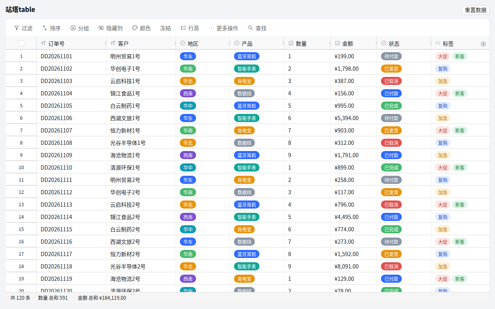
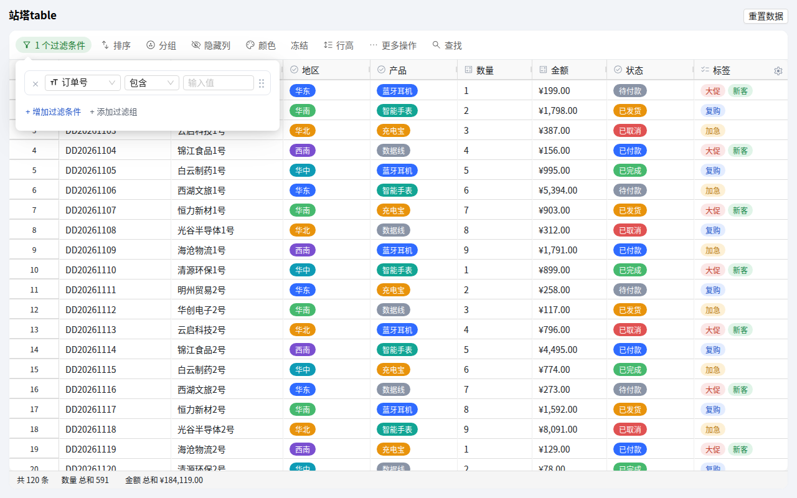
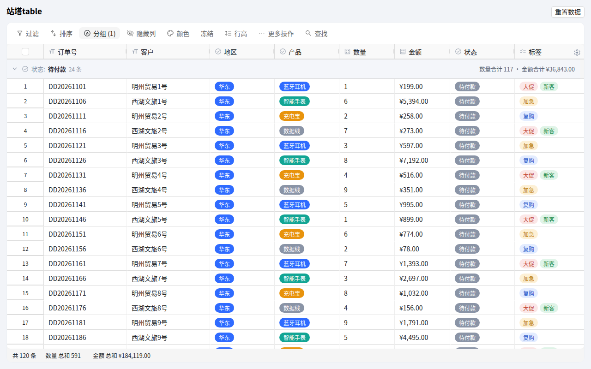
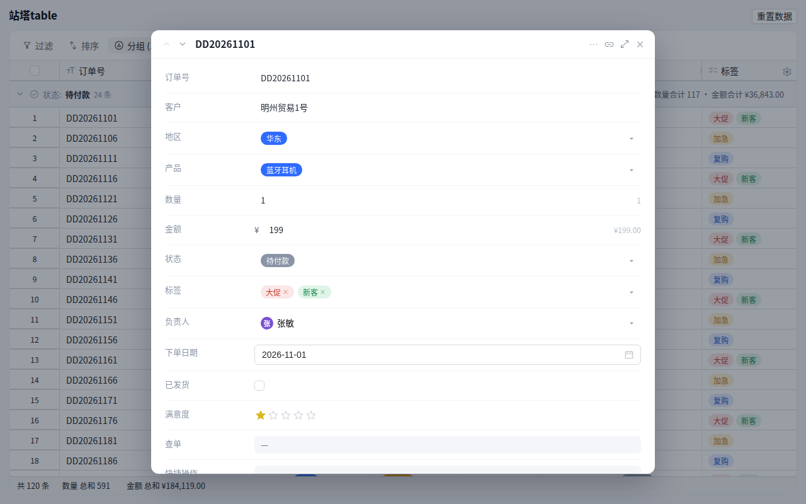
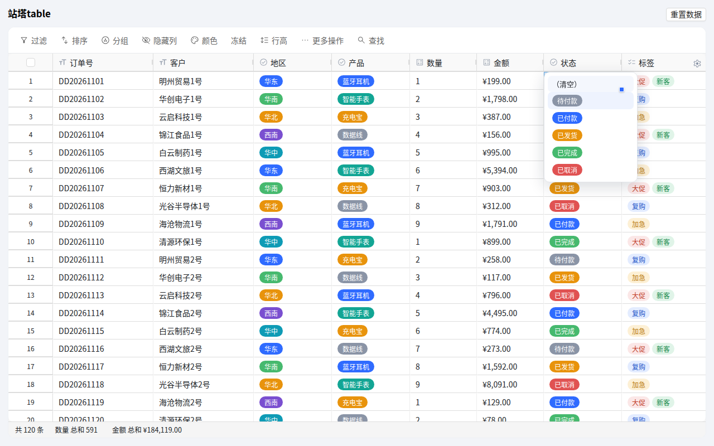

# 站塔table

## 这是什么

站塔table 是一套**纯前端**的在线表格组件（类 Airtable 的网格表格），由深圳市二十四小时网络科技有限公司开发并开源。

**在线演示：** [https://sz24hours.com/grid-demo.html](https://sz24hours.com/grid-demo.html)（免登录，打开即可完整体验）

本仓库**只包含前端**：表格组件本体 + 一个可直接运行的演示页。组件不发任何网络请求——数据由宿主通过 props 传入，用户的所有编辑通过回调函数抛回给宿主，宿主可以对接任意后端（REST、GraphQL、自研服务均可）。

演示页内置 120 行示例数据，全部操作（编辑、粘贴、筛选、分组……）都只发生在浏览器内存里，刷新即还原，**不需要任何后端就能完整体验**。

> **需要后端？** 本仓库不含后端服务。如需完整的站塔table 产品（含后端、多人协作、权限、云端存储与私有化部署），或希望我们协助对接后端，请联系我们：**sz24hours@gmail.com**。

## 界面截图

主界面（网格 + 工具栏 + 底部汇总行）：



筛选（按字段类型提供算符的条件筛选面板）：



分组（分组小计与总计行）：



行详情（居中弹窗，逐字段查看与编辑）：



单元格编辑（按字段类型打开对应编辑器）：



## 功能说明

### 字段类型（24 种）

- **基础（14）**：文本、长文本、数字、成员、日期、时长、单选、多选、附件、邮件、链接、复选框、评分、电话号码
- **高级（10）**：公式、链接其他记录、链接公式、数字签名、创建者、创建时间、修改者、修改时间、自动序号、按钮

每种字段类型都有对应的单元格渲染、编辑器、复制文本格式与筛选算符；数字支持千分位/货币/百分比等格式，日期支持国际/美国/欧洲等显示格式，单选/多选选项带颜色胶囊，复选框支持 7 种勾选样式，评分支持星/心/赞/旗四种图标。

### 网格编辑

- 双击、F2、回车或直接打字进入编辑；方向键/Tab 移动，Esc 取消，Enter 提交
- 框选区域、复制/粘贴（与 Excel、WPS、网页表格互通的 TSV 格式，粘贴时按字段类型逐格校验，无效或只读单元格自动跳过并给出回执）
- 填充柄拖拽填充；整列/整行选择；行勾选（勾选后汇总只统计勾选行）
- 删除带撤销提示；查找和替换（限文本类字段）

### 视图层

- **筛选**：条件面板，按字段类型给出可用算符（包含/等于/为空/介于/大于……），多条件组合
- **排序**：多列排序，可逐列升/降序
- **分组**：按任意可分组字段分组，带分组小计行与底部总计行
- **列管理**：隐藏/显示列、拖拽列宽、冻结列、列锁定
- **着色**：按条件给单元格或整行着色
- **行高**：多档行高切换
- **汇总**：底部汇总行，每列可切换聚合方式（合计/平均/中位数/最小值/最大值/计数）
- **打印**：按当前视图打印简表
- 视图状态（筛选/排序/分组/列宽等）整体作为一个 view 对象由宿主持久化，演示页中保存在 localStorage

### 高级字段

- **链接其他记录**：单元格里以记录药丸呈现，点开是记录选择器（搜索 + 卡片列表）和已链记录面板，可打开被链记录的详情
- **公式 / 链接公式**：字段定义、编辑入口、展示、筛选与排序支持（求值引擎在完整版后端中提供，见下方「关于后端」）
- **数字签名**：手写签名板（鼠标/触控书写、清除重写）
- **按钮**：按钮列可配置多个动作，点击后经宿主回调 `buttonExec` 逐个执行（改行、打开链接等动作的实际执行由宿主实现）

### 行详情与协作组件

- 行详情弹窗：逐字段查看/编辑、评论、修改历史（旧值 → 新值对照）
- 评论面板：右侧停靠面板 + 单元格评论计数徽标
- 修改日志渲染组件：操作人 + 动作 + 变更对照 + 时间
- 数据处理：计算总和 / 求差值 / 计算百分比 / 计算排名 / 提取用户名 / 比较和复制 / 自动添加链接等表级操作面板

## 技术栈与二次封装说明

本项目不是从零手写网格，也不是 Ant Design ProTable 的封装，具体构成如下：

| 层 | 基础 | 说明 |
| --- | --- | --- |
| 网格内核 | **AG Grid Community**（`ag-grid-react` 36.3） | 虚拟滚动、单元格渲染/编辑生命周期、选择模型由 AG Grid 提供；在此之上**二次封装**了字段渲染器、编辑器、浮层系统与整套视图行为 |
| UI 组件 | **Ant Design 6** | 按钮、抽屉、弹窗、消息提示等通用组件 |
| 拖拽 | **@dnd-kit** | 列/视图相关的拖拽排序 |
| 字段系统 | 自研 | `src/zttable/fields.js`：24 种字段类型的注册表（图标、格式化、算符、校验） |
| 数据管线 | 自研 | `src/zttable/pipeline.js`：筛选 → 排序 → 分组（含聚合）在客户端内存中完成；批量粘贴/填充经同一管线应用并回执 |
| 视图层 | 自研 | `src/zttable/Toolbar.jsx`、`ZtTable.jsx`：筛选/排序/分组/列设置/着色/汇总等视图能力 |

图标使用 Material Symbols Rounded 的 SVG 路径数据自托管（`src/components/msIcons.js`），不依赖外部字体服务。

## 环境要求

- **Node.js ≥ 20**（Vite 7 要求 Node 20.19+ 或 22+）
- npm ≥ 10（yarn / pnpm 亦可，命令等价替换）
- 现代浏览器（Chrome / Edge / Firefox / Safari 最新版）

不需要数据库、不需要任何后端服务、不需要注册账号。

## 快速开始

```bash
# 1. 克隆
git clone https://github.com/sz24hours-tech/zhanta-table.git
cd zhanta-table

# 2. 安装依赖
npm install

# 3. 启动开发服务器（默认 http://localhost:5173）
npm run dev
```

打开浏览器访问终端里给出的地址即可看到演示表格：120 行订单示例数据，可以直接编辑、筛选、分组、粘贴。

## 构建

```bash
# 常规构建：产物在 dist/（index.html + assets），用任意静态服务器托管
npm run build
npm run preview   # 本地预览构建产物

# 单文件构建：把 JS/CSS 全部内联进一个 grid-demo.html，单个文件即可打开/分发
npm run build:single
```

## 目录结构

```
.
├── index.html              # 演示页 HTML 入口
├── vite.config.js          # Vite 配置（@ 别名指向 src/）
├── inline.mjs              # 单文件打包脚本（build:single 使用）
├── src/
│   ├── main.jsx            # 演示入口
│   ├── DemoPage.jsx        # 演示页：示例字段/数据 + 组件接线示例（对接后端时主要参考这个文件）
│   ├── style.css           # 演示页外壳样式
│   ├── components/
│   │   ├── MsIcon.jsx      # 图标组件
│   │   ├── msIcons.js      # Material Symbols 图标路径数据（自托管）
│   │   └── msicon.css
│   └── zttable/            # 表格组件本体
│       ├── ZtTable.jsx     # 组件顶层：工具栏 + 网格 + 浮层编排
│       ├── ZtGrid.jsx      # 网格层（AG Grid 二次封装）
│       ├── Toolbar.jsx     # 工具栏：筛选/排序/分组/列设置/查找/打印
│       ├── fields.js       # 字段类型注册表
│       ├── pipeline.js     # 客户端数据管线：筛选/排序/分组/批量应用
│       ├── RowDetail.jsx   # 行详情弹窗
│       ├── CommentPanel.jsx# 评论面板
│       ├── LogList.jsx     # 修改日志渲染
│       ├── LinkPicker.jsx  # 链接记录选择器/已链面板
│       ├── LinkSettings.jsx# 链接列设置
│       ├── AddLinkRecordDialog.jsx # 添加链接记录
│       ├── DataOps.jsx     # 数据处理操作面板
│       ├── SignaturePad.jsx# 数字签名板
│       ├── overlay.js      # 浮层（菜单/面板）基础设施
│       └── zttable.css     # 组件样式
└── docs/screenshots/       # 本 README 的界面截图
```

## 对接自己的后端

组件本身不发请求。宿主（参考 `src/DemoPage.jsx`）负责三件事：

**1. 传入数据**

```js
fields = [
  { id: 'f_no',     name: '订单号', type: 'text' },
  { id: 'f_amount', name: '金额',   type: 'number', config: { format: 'currency', currency: 'CNY' } },
  { id: 'f_status', name: '状态',   type: 'select', config: { options: [{ id: 's1', label: '已付款', color: 'blue' }] } },
  // …其余字段，type/config 见 fields.js 的类型注册表
];
rows = [
  { id: 'r1', version: 1, cells: { f_no: 'DD001', f_amount: 199, f_status: 's1' } },
];
members = [{ uid: 'm1', name: '张三' }];   // 成员字段的候选人
view = {};                                  // 视图状态：筛选/排序/分组/列宽…，由宿主保存
```

**2. 接收变更回调**

- `onCellCommit(rowId, fieldId, value)`：单个单元格提交，返回 Promise（可在此调你的保存接口）
- `onBatch(ops, mode)`：粘贴/填充等批量操作，演示页用 `pipeline.js` 的 `applyBatchLocally` 在本地应用；对接后端时可把 ops 发给服务端
- `onViewChange(patch)`：视图状态变化，宿主持久化后下次传回 `view`

**3. 可选宿主能力**（行详情、评论、按钮动作等）：通过 `rowDetail` 等 props 注入，见 `DemoPage.jsx` 与各组件 props 定义。

## 关于后端

本仓库刻意不含后端：公式求值、多人实时协作、权限与共享、附件存储、数据持久化都在完整版的后端服务中。  

- 想直接用完整产品（云端版或私有化部署）：联系 **sz24hours@gmail.com**
- 想自己写后端：按上面「对接自己的后端」的回调契约即可，组件不限制后端语言与框架
- 需要我们协助对接/定制：同样邮件联系

## 许可证

本项目以 **AGPL-3.0** 许可证开源（全文见 [LICENSE](LICENSE)）。

简单说：你可以自由使用、修改、分发本项目，包括商用；但只要你把修改后的版本通过网络对外提供服务，就必须同样以 AGPL-3.0 开源你的修改。**如需闭源商用授权**（不履行 AGPL 开源义务的使用方式），请联系 sz24hours@gmail.com 获取商业授权。

Copyright © 深圳市二十四小时网络科技有限公司 (Shenzhen 24 Hours Network Technology Co., Ltd.)
